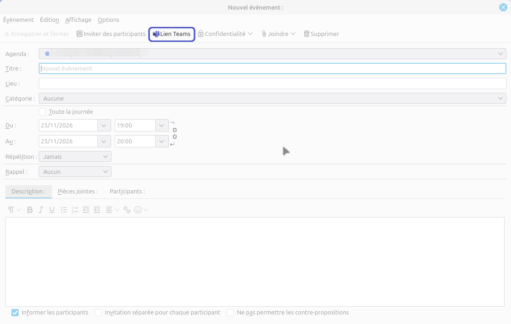
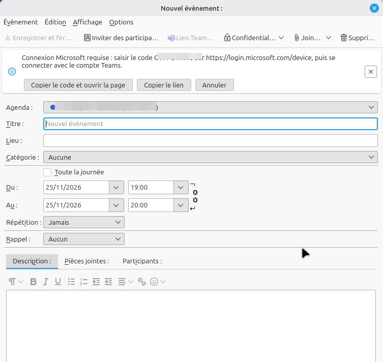
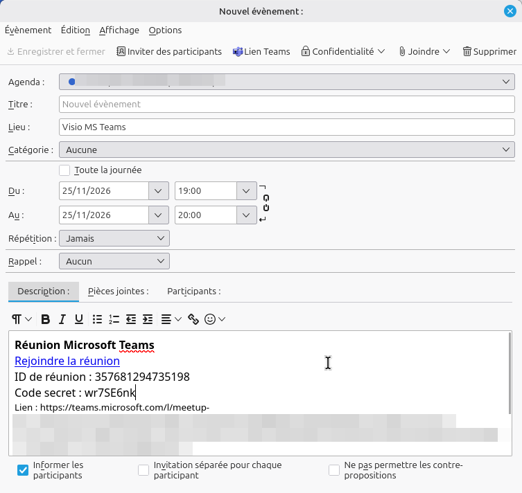

# Teams Meeting Link for Thunderbird

[Français](README.md) | **English**

Thunderbird add-on that adds a **Lien Teams** ("Teams link") button to the "New Event" window. One click creates a unique Microsoft Teams meeting with the event title and time, then inserts the join link into the description.

Each meeting gets its own ID, chat and recordings, unlike a permanent link reused over and over. Attendees and agenda stay in Thunderbird; Teams only provides the video call. The title and time are then kept up to date on the Teams side every time the event is saved.

Unofficial add-on, not affiliated with Microsoft.

The user interface is currently in French; the screenshots below show the French labels.



## Status

Version 3.0.0 (final add-on ID). Behaviour validated with 2.3.3 in Thunderbird 153 ESR: sign-in through the notification bar, meeting creation, insertion of the block and of the Location, update of the Teams meeting when the event is saved.

## Contents

- [Status](#status)
- [Requirements](#requirements)
- [Installation](#installation)
- [Microsoft sign-in](#microsoft-sign-in)
- [Usage](#usage)
- [Automatic update](#automatic-update)
- [Recurring events](#recurring-events)
- [Options](#options)
- [Architecture](#architecture)
- [Data and privacy](#data-and-privacy)
- [Known limitations](#known-limitations)
- [Troubleshooting](#troubleshooting)
- [Development](#development)
- [License](#license)

## Requirements

- **Microsoft 365 work or school account** (Entra ID tenant) with Teams. Personal accounts (outlook.com, hotmail…) are not supported by the Microsoft Graph `onlineMeetings` API: creation fails with a 403 error.
- **Thunderbird 128 or later** (tested on 153 ESR), with Experiment add-ons allowed (default setting, `extensions.experiments.suppressed = false`).
- No additional software: all the logic (sign-in, Microsoft calls) is built into the add-on.

## Installation

1. Thunderbird: ☰ > Add-ons and Themes > ⚙️ > **Install Add-on From File**.
2. Select the `teams-meeting-link-<version>.xpi` package (available on the [Releases](https://github.com/ctaverne/thunderbird-teams-meeting-link/releases) page).
3. Accept the **full access** request. This access is required by the Experiment API (button in the event window, calendar observation).
4. Restart Thunderbird, recommended after each installation or update: Experiment API code can stay in memory until restart.

The installed version is shown on the add-on page in the Add-ons Manager.

## Microsoft sign-in

First step, done only once: sign-in to the Microsoft 365 account that holds Teams. It uses the **device code flow** (OAuth 2.0, Microsoft Entra ID) and can also be started beforehand from the [options](#options) (**Se connecter** button).

- On the first click on **Lien Teams**, a notification bar appears at the top of the event window: "Connexion Microsoft requise : saisir le code XXXXXXXX sur https://login.microsoft.com/device…" (Microsoft sign-in required: enter the code on the sign-in page, then sign in with the Teams account).



- **Copier le code et ouvrir la page** (copy the code and open the page): the code is copied to the clipboard and the sign-in page opens in the default browser.
- **Copier le lien** (copy the link): copies the sign-in address, to open it in another browser or profile.
- **Annuler** (cancel) stops the sign-in; closing the event window has the same effect.
- Once sign-in is complete (password and MFA in the browser), the bar disappears and creation continues without another click.

The refresh token is then kept by the add-on and renewed automatically. A new sign-in is only requested after a long period of inactivity (about 90 days), after signing out from the options, or after changing the application or tenant.

Only the delegated permissions `OnlineMeetings.ReadWrite` and `offline_access` are requested.

### Application ID

Every token request names an application registered with Microsoft, whose name is shown on the consent page. By default, Microsoft's public application "Microsoft Graph Command Line Tools" is used: it is known to every tenant and needs no registration. Two caveats apply for public distribution:

- the consent page shows the name of that Microsoft application, not the add-on's;
- Microsoft or a tenant may restrict its use (Conditional Access policies, blocking of the device code flow).

A dedicated application can replace it from the [options](#options):

1. entra.microsoft.com > Applications > App registrations > **New registration**;
2. supported account types: "Accounts in any organizational directory (multitenant)"; no redirect URI;
3. Authentication > Advanced settings > **Allow public client flows: Yes**;
4. API permissions > Microsoft Graph > Delegated permissions > **OnlineMeetings.ReadWrite** (no tenant-wide admin consent);
5. copy the **Application (client) ID** into the add-on options.

Without Microsoft publisher verification, the application is shown as "unverified"; tenants that only allow verified publishers then require administrator consent.

## Usage

Sign-in to the Microsoft account (previous section) is offered automatically on the first click on **Lien Teams**; creation then continues with no further action.

1. Open a new event; enter the title, time, attendees and agenda (in any order).
2. Click **Lien Teams** (button placed after "Invite Attendees"). The button shows "Lien Teams…" while the meeting is being created.
3. The following block is appended to the description:

   ```
   Réunion Microsoft Teams
   Rejoindre la réunion            (clickable link)
   ID de réunion : 123 456 789
   Code secret : Ab12Cd
   Lien : https://teams.microsoft.com/l/meetup-join/...
   ```

   The short link at the top prevents the event summary window from scrolling to the end of the (very long) address. The full address remains in plain text for attendees, calendar server synchronisation and the automatic update.

4. The **Location** field is set to "Visio MS Teams" when empty; an existing location is never overwritten.

   

5. Save and send the invitation as usual.

If the title is still empty when clicking, the meeting is created as "Réunion", then renamed when the event is saved. If the description already contains a Teams link, a confirmation is requested before creating a second one.

## Automatic update

Each time an event is added or modified (saved from the window, moved in the calendar view, synchronised), the add-on looks for a Teams link in the description. If the title or time differs from the Teams meeting, the meeting is updated and a "Réunion Teams mise à jour" (Teams meeting updated) notification is shown.

- Only the user's own events are processed: writable calendar, organizer matching the calendar identity, received invitations excluded. An attendee who knows the link therefore cannot change the meeting by sending back a modified event.
- Teams links from other organizers are recognised as foreign and ignored; a foreign link is only checked again after 24 hours.
- Without any change, no call is made to Microsoft.
- Successive notifications for the same event are grouped (3-second delay).
- No sign-in is offered in the background: if the session has expired, a notification asks to click **Lien Teams** to sign in again.
- A meeting missing from the local cache (after a reinstall, for example) is found again on Microsoft's side from its link.

## Recurring events

Recurrence is handled in Thunderbird. A single Teams meeting serves the whole series, as usual in Teams and Outlook: the chat and recordings of the series stay together. The first occurrence (parent event) is used as the reference for updates.

Teams expires a meeting 60 days after its end date, a delay extended each time an attendee joins. A regular series is not affected; a series with more than 60 days between two occurrences may be.

## Options

Access: Add-ons Manager > Teams Meeting Link for Thunderbird > **Options**.

| Setting | Default | Purpose |
|---|---|---|
| Sign-in status | | Status, **Se connecter** (sign in, code shown in a small window) and **Se déconnecter** (sign out) buttons |
| Application ID (client ID) | `14d82eec-204b-4c2f-b7e8-296a70dab67e` | Entra ID application used for sign-in |
| Tenant | `organizations` | `organizations` (any work account) or a specific tenant ID |

Changing the application or tenant removes the current session.

## Architecture

```
extension/
├── manifest.json            Manifest (MV2), permissions, Experiment API
├── api/
│   ├── schema.json          Schema of the "lienTeams" Experiment API
│   └── implementation.js    Privileged part: button, sign-in bar, insertion, calendar observation
├── background/
│   ├── config.js            Configuration (client ID, tenant), storage
│   ├── auth.js              Device code sign-in, tokens, renewal
│   ├── graph.js             Microsoft Graph calls (create, find, update)
│   └── background.js        Glue between the Experiment API and Microsoft
├── connexion/               Sign-in window (sign-in started from the options)
├── options/                 Options page
└── icones/                  Logo (SVG and PNG 16 to 128 px)
```

### `lienTeams` Experiment API

The Experiment API is limited to features with no equivalent in Thunderbird's WebExtension APIs.

| Item | Type | Purpose |
|---|---|---|
| `onBoutonClique(idFenetre, {titre, debut, fin})` | event | Click on the button of an event window |
| `onEvenementEnregistre({lien, titre, debut, fin})` | event | Added or modified event containing a Teams link |
| `onConnexionAnnulee(idFenetre)` | event | "Annuler" button of the sign-in bar |
| `insererBloc(idFenetre, reunion)` | function | Insert the block into the description, Location when empty |
| `definirOccupe(idFenetre, occupe)` | function | "Creating" state of the button |
| `alerter(idFenetre, titre, message)` | function | Error message in the event window |
| `afficherCodeConnexion(idFenetre, code, url)` | function | Sign-in bar |
| `masquerCodeConnexion(idFenetre)` | function | Remove the sign-in bar |
| `estOuverte(idFenetre)` | function | Event window still open |

Technical notes:

- the button is added by a window listener on `chrome://calendar/content/calendar-event-dialog.xhtml` (dialog mode, `calendar.item.editInTab = false`);
- the title is read from `#item-title`, the time from the `gStartTime` and `gEndTime` variables of the `calendar-item-panel-iframe` iframe;
- the block is inserted with the description's HTML editor (`insertHTML`), which marks the description as modified and guarantees it is saved;
- the sign-in bar uses the notification box provided by Thunderbird (`#event-dialog-notifications`), in the foreground of the event window;
- calendar observation relies on `cal.manager.addCalendarObserver`;
- the event window only accepts `chrome:` images (CSP `default-src chrome:`): the `icones/` folder is registered as a chrome package and the button icon is served from `chrome://lienteams/content/teams-32.png`.

### Microsoft Graph calls

| Action | Request |
|---|---|
| Create | `POST /v1.0/me/onlineMeetings` (`subject`, `startDateTime`, `endDateTime`) |
| Find by link | `GET /v1.0/me/onlineMeetings?$filter=JoinWebUrl eq '…'` |
| Update | `PATCH /v1.0/me/onlineMeetings/{id}` |

## Data and privacy

- **Sent to Microsoft**: event title and time (creation and update), link of the meetings to identify. Neither attendees, nor the description, nor any other calendar data are sent.
- **Stored locally** (the add-on's `storage.local`, removed on uninstall): configuration, Microsoft tokens, cache of known meetings (ID, title, time) and of foreign links.
- No other service is contacted.

## Known limitations

- Personal Microsoft accounts are not supported (Graph API limitation).
- The button is only available in the event dialog window, not when editing in a tab.
- Deleting the event does not delete the Teams meeting.
- Updates are only applied while Thunderbird is running with the add-on enabled.
- Meetings created by the add-on do not appear in the Teams/Outlook calendar (behaviour of the `onlineMeetings` API); the Thunderbird calendar is the reference.
- User interface in French only for now.

## Troubleshooting

| Symptom | Likely cause / action |
|---|---|
| 403 error on creation | Personal account, licence without Teams, or administrator consent required in the tenant |
| Button missing | Add-on disabled or not installed; editing in a tab instead of the dialog; restart Thunderbird after an update |
| Version unchanged after update | Remove the add-on, reinstall from file, then restart |
| Button stuck on "Lien Teams…" | Sign-in pending: complete the sign-in or click Annuler in the bar |
| "Fenêtre d'événement non prête" (event window not ready) | Clicked too soon after opening the window; try again |
| "Connexion requise" (sign-in required) notification | Session expired: click Lien Teams or the Se connecter button in the options |
| Other error | Thunderbird console (Ctrl+Shift+J), lines mentioning "Lien Teams" or `lienteams` |

## Development

Build the package after changing the sources:

```bash
cd extension
# Bump "version" in manifest.json, then:
zip -qr ../teams-meeting-link-<version>.xpi manifest.json LICENSE api background connexion options icones
```

Load test without touching the main profile (throwaway profile, headless):

```bash
P=$(mktemp -d)
mkdir -p "$P/extensions"
cp ../teams-meeting-link-<version>.xpi "$P/extensions/{0a31aea7-bc43-4855-8cd8-0422f60734ce}.xpi"
cat > "$P/user.js" <<'EOF'
user_pref("extensions.autoDisableScopes", 0);
user_pref("devtools.console.stdout.chrome", true);
user_pref("devtools.console.stdout.content", true);
EOF
timeout 40 thunderbird --headless --no-remote --profile "$P"
```

Add-on errors are then printed on standard output. This test checks that the add-on and its API load; the button, the sign-in bar and the sign-in itself are tested in Thunderbird with a display.

The add-on ID is `{0a31aea7-bc43-4855-8cd8-0422f60734ce}` (GUID format). It must not change: a new ID would force users to reinstall the add-on.

## License

Mozilla Public License 2.0 (`LICENSE` file), except for the logo, taken from the Papirus icon theme under the GPL 3.0 license (see `extension/icones/LISEZMOI-ICONES.md`). Microsoft and Microsoft Teams are trademarks of Microsoft Corporation; unofficial add-on, not affiliated with Microsoft.
