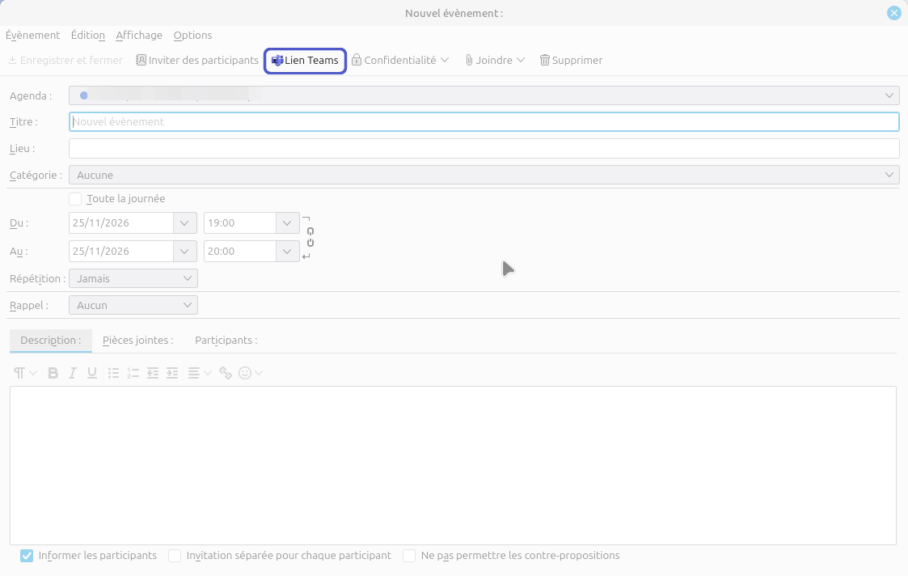
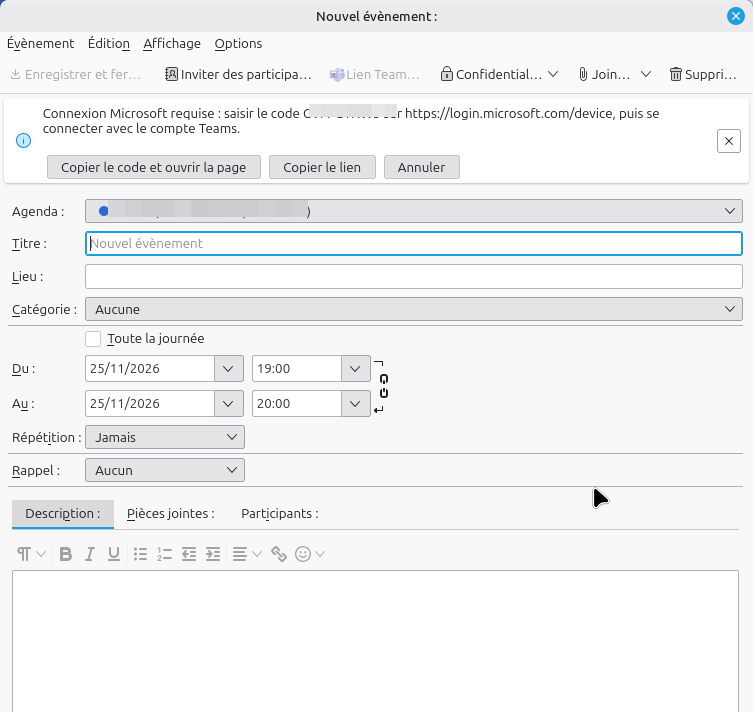
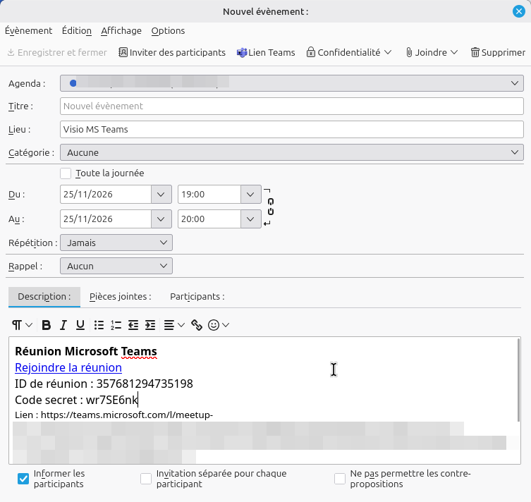

# Teams Meeting Link for Thunderbird

**Français** | [English](README.en.md)

Extension Thunderbird qui ajoute un bouton **Lien Teams** dans la fenêtre « Nouvel événement ». Un clic crée une réunion Microsoft Teams unique, avec le titre et l'horaire de l'événement, puis insère le lien de connexion dans la description.

Chaque réunion reçoit son propre identifiant, sa propre conversation et ses propres enregistrements. Les participants et l'ordre du jour restent saisis dans Thunderbird ; Teams ne fournit que la visio. Le titre et l'horaire sont ensuite tenus à jour côté Teams à chaque enregistrement de l'événement.

Extension non officielle, sans lien avec Microsoft.

> **Compte requis : compte Microsoft 365 professionnel ou scolaire** (organisation Entra ID utilisant Teams, en pratique via un abonnement Microsoft 365 ou Teams pour les entreprises, ou une offre Éducation). Les comptes Microsoft personnels (outlook.com, hotmail), dont Teams gratuit, ne fonctionnent pas : l'API Microsoft de création de réunions ne les prend pas en charge.



## État

Version 3.0.1 (identifiant définitif, compatible jusqu'à Thunderbird 153). Fonctionnement validé en 2.3.3 dans Thunderbird 153 ESR : connexion par bandeau, création de la réunion, insertion du bloc et du Lieu, mise à jour de la réunion Teams à l'enregistrement de l'événement.

## Sommaire

- [État](#état)
- [Prérequis](#prérequis)
- [Installation](#installation)
- [Connexion Microsoft](#connexion-microsoft)
- [Utilisation](#utilisation)
- [Mise à jour automatique](#mise-à-jour-automatique)
- [Réunions récurrentes](#réunions-récurrentes)
- [Options](#options)
- [Architecture](#architecture)
- [Données et confidentialité](#données-et-confidentialité)
- [Limites connues](#limites-connues)
- [Dépannage](#dépannage)
- [Développement](#développement)
- [Licence](#licence)

## Prérequis

- **Compte Microsoft 365 professionnel** (tenant Entra ID) disposant de Teams. Les comptes personnels (outlook.com, hotmail…) ne sont pas pris en charge par l'API Microsoft Graph `onlineMeetings` : la création échoue avec une erreur 403.
- **Thunderbird 128 à 153** (testé sur 153 ESR ; ATN impose une version maximale aux extensions expérimentales, relevée après test de chaque nouvelle version), avec les extensions expérimentales autorisées (réglage par défaut, `extensions.experiments.suppressed = false`).
- Aucun logiciel complémentaire : toute la logique (connexion, appels Microsoft) est intégrée à l'extension.

## Installation

1. Thunderbird : ☰ > Modules complémentaires et thèmes > ⚙️ > **Installer un module depuis un fichier**.
2. Sélection du paquet `teams-meeting-link-<version>.xpi`.
3. Acceptation de la demande d'**accès complet**. Cet accès est requis par l'API expérimentale (bouton dans la fenêtre d'événement, observation des agendas).
4. Redémarrage de Thunderbird, conseillé après chaque installation ou mise à jour : le code d'une API expérimentale peut rester en mémoire jusqu'au redémarrage.

La version installée est visible sur la fiche de l'extension dans le gestionnaire de modules.

## Connexion Microsoft

Première étape, à faire une seule fois : la connexion au compte Microsoft 365 qui porte Teams. Elle utilise le **flux par code d'appareil** (OAuth 2.0, Microsoft Entra ID) et peut aussi être lancée à l'avance depuis les [options](#options) (bouton **Se connecter**).

- Au premier clic sur **Lien Teams**, un bandeau s'affiche en haut de la fenêtre d'événement : « Connexion Microsoft requise : saisir le code XXXXXXXX sur https://login.microsoft.com/device, puis se connecter avec le compte Teams ».


- **Copier le code et ouvrir la page** : le code est copié dans le presse-papiers et la page de connexion s'ouvre dans le navigateur par défaut.
- **Copier le lien** : copie de l'adresse de connexion, pour l'ouvrir dans un autre navigateur ou un autre profil.
- **Annuler** interrompt la connexion ; la fermeture de la fenêtre d'événement a le même effet.
- Une fois la connexion validée (mot de passe et MFA dans le navigateur), le bandeau disparaît et la création se poursuit sans nouveau clic.

Le jeton d'actualisation est ensuite conservé par l'extension et renouvelé sans intervention. Une nouvelle connexion n'est demandée qu'après une longue inactivité (environ 90 jours), après une déconnexion depuis les options, ou après un changement d'application ou de tenant.

Seules les permissions déléguées `OnlineMeetings.ReadWrite` et `offline_access` sont demandées.

### Identifiant d'application

Toute demande de jeton désigne une application inscrite chez Microsoft, dont le nom s'affiche sur la page d'accord. Par défaut, l'application publique de Microsoft « Microsoft Graph Command Line Tools » est utilisée : elle est connue de tous les tenants et ne demande aucune inscription. Deux réserves s'y attachent pour une diffusion publique :

- la page d'accord affiche le nom de cette application Microsoft, pas celui de l'extension ;
- Microsoft ou un tenant peut en restreindre l'usage (règles d'accès conditionnel, blocage de la connexion par code d'appareil).

Une application dédiée peut la remplacer depuis les [options](#options) :

1. entra.microsoft.com > Applications > Inscriptions d'applications > **Nouvelle inscription** ;
2. types de comptes : « Comptes dans un annuaire d'organisation (multilocataire) » ; aucun URI de redirection ;
3. Authentification > Paramètres avancés > **Autoriser les flux clients publics : Oui** ;
4. Autorisations d'API > Microsoft Graph > Autorisations déléguées > **OnlineMeetings.ReadWrite** (sans consentement administrateur global) ;
5. report de l'**ID d'application (client)** dans les options de l'extension.

Sans vérification d'éditeur Microsoft, l'application apparaît comme « non vérifiée » ; les tenants qui n'autorisent que les éditeurs vérifiés exigent alors l'accord d'un administrateur.

## Utilisation

Sans connexion au compte Microsoft (section précédente), le premier clic sur **Lien Teams** la propose ; la création reprend ensuite sans autre clic.

1. Ouverture d'un nouvel événement ; saisie du titre, de l'horaire, des participants et de l'ordre du jour (dans n'importe quel ordre).
2. Clic sur **Lien Teams** (bouton placé après « Inviter des participants » ; son infobulle indique si la connexion Microsoft reste à faire). Pendant l'appel à Microsoft, le bouton affiche « Création… » et un bandeau « Création de la réunion Teams en cours… » s'affiche en haut de la fenêtre ; il devient « Réunion Teams créée : lien ajouté à la description », puis disparaît après 5 secondes. En cas d'échec, le bandeau affiche le motif et reste visible.
3. Le bloc suivant est ajouté à la fin de la description :

   ```
   Réunion Microsoft Teams
   Rejoindre la réunion            (lien cliquable)
   ID de réunion : 123 456 789
   Code secret : Ab12Cd
   Lien : https://teams.microsoft.com/l/meetup-join/...
   ```

   Le lien court en tête évite que la fenêtre de résumé d'un événement ne défile jusqu'à la fin de l'adresse. L'adresse complète reste présente en texte simple pour les invités, la synchronisation avec le serveur d'agenda et la mise à jour automatique.

4. Le champ **Lieu** reçoit « Visio MS Teams » s'il est vide ; un lieu déjà saisi n'est jamais écrasé.

   

5. Enregistrement et envoi de l'invitation, comme d'habitude.

Si le titre est encore vide au moment du clic, la réunion est créée sous le nom « Réunion », puis renommée à l'enregistrement de l'événement. Si la description contient déjà un lien Teams, une confirmation est demandée avant d'en créer un second.

## Mise à jour automatique

À chaque ajout ou modification d'un événement (enregistrement de la fenêtre, déplacement dans la vue agenda, synchronisation), l'extension recherche un lien Teams dans la description. Si le titre ou l'horaire diffère de la réunion Teams, celle-ci est mise à jour et une notification « Réunion Teams mise à jour » s'affiche.

- Seuls les événements de l'utilisateur sont traités : agenda modifiable, organisateur correspondant à l'identité de l'agenda, invitations reçues exclues. Un invité qui renvoie un événement retouché avec le même lien ne modifie pas la réunion.
- Les liens Teams d'autres organisateurs (invitations reçues) sont reconnus comme étrangers et ignorés ; un lien étranger n'est revérifié qu'après 24 heures.
- Sans changement, aucun appel à Microsoft n'est effectué.
- Les notifications successives d'un même événement sont regroupées (délai de 3 secondes).
- Aucune connexion n'est proposée en arrière-plan : si la connexion a expiré, une notification invite à cliquer sur **Lien Teams** pour se reconnecter.
- Une réunion absente du cache local (après une réinstallation, par exemple) est retrouvée auprès de Microsoft à partir de son lien.

## Réunions récurrentes

La récurrence est gérée dans Thunderbird. Une seule réunion Teams sert à toute la série, comme dans Teams et Outlook : la conversation et les enregistrements de la série restent regroupés. La première occurrence (événement parent) sert de référence pour la mise à jour.

Teams fait expirer une réunion 60 jours après sa date de fin, délai prolongé à chaque connexion d'un participant. Une série régulière n'est pas concernée ; une série espacée de plus de 60 jours entre deux occurrences peut l'être.

## Options

Accès : gestionnaire de modules > Teams Meeting Link for Thunderbird > **Options**.

| Réglage | Défaut | Rôle |
|---|---|---|
| État de la connexion | | Affichage, boutons **Se connecter** (code présenté dans une petite fenêtre) et **Se déconnecter** |
| Identifiant d'application (client ID) | `14d82eec-204b-4c2f-b7e8-296a70dab67e` | Application Entra ID utilisée pour la connexion |
| Tenant | `organizations` | `organizations` (tout compte professionnel) ou identifiant d'un tenant précis |

Un changement d'application ou de tenant supprime la connexion en cours.

## Architecture

```
extension/
├── manifest.json            Manifeste (MV2), permissions, API expérimentale
├── api/
│   ├── schema.json          Schéma de l'API expérimentale « lienTeams »
│   └── implementation.js    Partie privilégiée : bouton, bandeau, insertion, observation des agendas
├── background/
│   ├── config.js            Configuration (client ID, tenant), stockage
│   ├── auth.js              Connexion par code d'appareil, jetons, renouvellement
│   ├── graph.js             Appels Microsoft Graph (création, recherche, modification)
│   └── background.js        Liaison entre l'API expérimentale et Microsoft
├── connexion/               Fenêtre de connexion (connexion lancée depuis les options)
├── options/                 Page d'options
└── icones/                  Logo (SVG et PNG 16 à 128 px)
```

### API expérimentale `lienTeams`

L'API expérimentale se limite aux fonctions sans équivalent dans les API WebExtension de Thunderbird.

| Élément | Type | Rôle |
|---|---|---|
| `onBoutonClique(idFenetre, {titre, debut, fin})` | événement | Clic sur le bouton d'une fenêtre d'événement |
| `onEvenementEnregistre({lien, titre, debut, fin})` | événement | Événement ajouté ou modifié contenant un lien Teams |
| `onConnexionAnnulee(idFenetre)` | événement | Bouton « Annuler » du bandeau de connexion |
| `insererBloc(idFenetre, reunion)` | fonction | Insertion du bloc dans la description, Lieu si vide |
| `definirOccupe(idFenetre, occupe)` | fonction | État « création en cours » du bouton |
| `alerter(idFenetre, titre, message)` | fonction | Message d'erreur dans la fenêtre d'événement |
| `afficherCodeConnexion(idFenetre, code, url)` | fonction | Bandeau de connexion |
| `masquerCodeConnexion(idFenetre)` | fonction | Retrait du bandeau |
| `afficherStatut(idFenetre, type, message, dureeMs)` | fonction | Bandeau de statut de la création (en cours, succès, erreur) |
| `masquerStatut(idFenetre)` | fonction | Retrait du bandeau de statut |
| `definirConnecte(etat)` | fonction | État de connexion, infobulle du bouton |
| `estOuverte(idFenetre)` | fonction | Fenêtre d'événement toujours ouverte |

Points techniques :

- le bouton est ajouté par un écouteur de fenêtres sur `chrome://calendar/content/calendar-event-dialog.xhtml` (mode popup, `calendar.item.editInTab = false`) ;
- le titre est lu dans `#item-title`, l'horaire dans les variables `gStartTime` et `gEndTime` de l'iframe `calendar-item-panel-iframe` ;
- le bloc est inséré par l'éditeur HTML de la description (`insertHTML`), ce qui marque la description comme modifiée et garantit son enregistrement ;
- le bandeau utilise la zone de notification prévue par Thunderbird (`#event-dialog-notifications`), au premier plan dans la fenêtre d'événement ;
- l'observation des agendas passe par `cal.manager.addCalendarObserver` ;
- la fenêtre d'événement n'accepte que les images `chrome:` (politique CSP `default-src chrome:`) : le dossier `icones/` est enregistré comme paquet chrome et l'icône du bouton est servie à l'adresse `chrome://lienteams/content/teams-32.png`.

### Appels Microsoft Graph

| Action | Requête |
|---|---|
| Création | `POST /v1.0/me/onlineMeetings` (`subject`, `startDateTime`, `endDateTime`) |
| Recherche par lien | `GET /v1.0/me/onlineMeetings?$filter=JoinWebUrl eq '…'` |
| Mise à jour | `PATCH /v1.0/me/onlineMeetings/{id}` |

## Données et confidentialité

- **Envoyés à Microsoft** : titre et horaire de l'événement (création et mise à jour), lien des réunions à identifier. Ni les participants, ni la description, ni aucune autre donnée de l'agenda ne sont transmis.
- **Conservés sur le poste** (`storage.local` de l'extension, supprimé à la désinstallation) : configuration, jetons Microsoft, cache des réunions connues (identifiant, titre, horaire) et des liens étrangers.
- Aucun autre service n'est contacté.

## Limites connues

- Comptes Microsoft personnels non pris en charge (limitation de l'API Graph).
- Bouton absent du mode d'édition en onglet : seule la fenêtre popup d'événement le propose.
- La suppression de l'événement ne supprime pas la réunion Teams.
- Les mises à jour ne sont reportées que lorsque Thunderbird est ouvert avec l'extension active.
- Les réunions créées par l'extension n'apparaissent pas dans le calendrier Teams/Outlook (comportement de l'API `onlineMeetings`) ; l'agenda Thunderbird fait référence.

## Dépannage

| Symptôme | Cause probable / action |
|---|---|
| Erreur 403 à la création | Compte personnel, licence sans Teams, ou consentement administrateur requis dans le tenant |
| Bouton absent | Extension désactivée ou non installée ; édition en onglet au lieu de la popup ; redémarrage de Thunderbird après mise à jour |
| Version affichée inchangée après mise à jour | Suppression de l'extension, réinstallation depuis le fichier, puis redémarrage |
| Bouton bloqué sur « Création… » | Connexion en attente : finaliser la connexion ou cliquer sur Annuler dans le bandeau |
| « Fenêtre d'événement non prête » | Clic trop rapide après l'ouverture de la fenêtre ; recommencer |
| Notification « connexion requise » | Connexion expirée : clic sur Lien Teams ou bouton Se connecter des options |
| Autre erreur | Console de Thunderbird (Ctrl+Maj+J), lignes mentionnant « Lien Teams » ou `lienteams` |

## Développement

Construction du paquet après modification des sources :

```bash
cd extension
# Incrémenter "version" dans manifest.json, puis :
zip -qr ../teams-meeting-link-<version>.xpi manifest.json LICENSE api background connexion options icones
```

Test de chargement sans toucher au profil principal (profil jetable, sans affichage) :

```bash
P=$(mktemp -d)
mkdir -p "$P/extensions"
cp ../teams-meeting-link-<version>.xpi "$P/extensions/{0a31aea7-bc43-4855-8cd8-0422f60734ce}.xpi"
cat > "$P/user.js" <<'EOF'
user_pref("extensions.autoDisableScopes", 0);
user_pref("devtools.console.stdout.chrome", true);
user_pref("devtools.console.stdout.content", true);
EOF
timeout 40 thunderbird --headless --no-remote --profile "$P"
```

Les erreurs de l'extension apparaissent alors sur la sortie standard. Ce test vérifie le chargement de l'extension et de son API ; le bouton, le bandeau et la connexion se testent dans Thunderbird avec affichage.

### Nouvelle version de Thunderbird

ATN exige une version maximale (`strict_max_version`) pour les extensions expérimentales. Pour une nouvelle version de Thunderbird :

1. test de l'extension dans cette version (bouton, bandeau de connexion, création, mise à jour à l'enregistrement) ;
2. report de la version dans `strict_max_version` du manifeste (par exemple `"159.*"`) et incrément de `version` ;
3. construction du paquet, envoi sur ATN et publication d'une version GitHub.

L'identifiant de l'extension est `{0a31aea7-bc43-4855-8cd8-0422f60734ce}` (format GUID). Il ne doit plus changer : un changement obligerait les utilisateurs à réinstaller l'extension.

## Licence

Mozilla Public License 2.0 (fichier `LICENSE`), à l'exception du logo, issu du thème d'icônes Papirus sous licence GPL 3.0 (voir `extension/icones/LISEZMOI-ICONES.md`). Microsoft et Microsoft Teams sont des marques de Microsoft Corporation ; extension non officielle, sans lien avec Microsoft.
